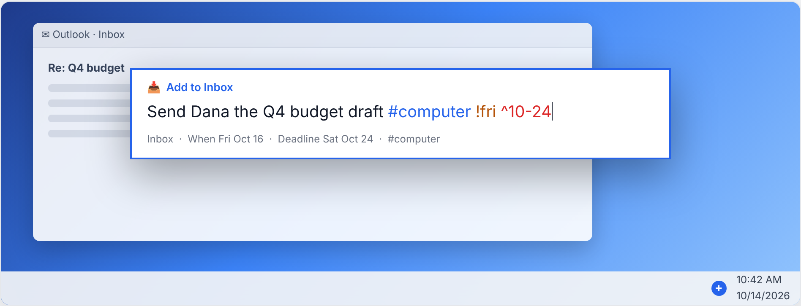

# Quick Capture — global shortcuts on Windows

TickTick-style keyboard shortcuts that add a task to this vault from **any** app. Press the combo,
type, and press `Enter`. The task lands in `00 Inbox/` as an ordinary capture (the same format as
`/gtd-capture` and the dashboard's New To-Do), ready for `/gtd-process-inbox`.

It's one PowerShell script in the system tray (`scripts/quick_capture/`, an optional git submodule —
[adamkopelman/gtd-quick-capture](https://github.com/adamkopelman/gtd-quick-capture)). It runs on the
Windows PowerShell 5.1 that comes with Windows 10/11, so there's nothing to install, and it doesn't
need Obsidian or the dashboard server to be running.

Demo, with pictures and a live syntax playground: open `docs/gtd/quick-capture-demo.html` in a browser.



## Setup (Windows)

0. If `scripts\quick_capture\` is empty, check out the submodule (cloning with
   `--recurse-submodules` already did): `git submodule update --init scripts/quick_capture`.
1. In File Explorer, open `scripts\quick_capture\` in the vault and double-click **`install.cmd`**.
   This adds *GTD Quick Capture* to your Startup folder, so it starts with Windows, and starts it
   now. A blue **+** icon appears in the tray. Windows may hide it under the `^` arrow; drag it onto
   the taskbar to keep it visible.
2. Press `Ctrl+Alt+A`, type `Test capture`, press `Enter`. You should see
   `00 Inbox/<today> test-capture.md`.

Run it without installing: double-click `start.cmd`. Remove it: double-click `uninstall.cmd`.
From a terminal: `powershell -ExecutionPolicy Bypass -File scripts\quick_capture\quick_capture.ps1 [-Install|-Uninstall]`.

The vault is the folder two levels above the script, so it works wherever you cloned the vault.
To point it at a different vault, set `"vault"` in the config.

## Shortcuts

| Default | Does |
| --- | --- |
| `Ctrl+Alt+A` | Quick add → `00 Inbox/` |
| `Ctrl+Alt+T` | Add to **Today**: `[scheduled:: today]` + `#next` (+ `#anywhere` if you typed no context) |
| `Ctrl+Alt+V` | Capture the clipboard with no popup. A short single line becomes a task. A link or a longer snippet becomes a plain note. |
| `Ctrl+Alt+D` | Open the local dashboard (`http://localhost:8787`). If it isn't running, `scripts/dashboard_server.py` is started first. |

In the popup: `Enter` saves · `Shift+Enter` saves and keeps the box open for the next one ·
`Esc` cancels. Left-click the tray icon to open the quick-add box. Right-click it for the menu
(the same actions, *Open inbox folder*, *Edit shortcuts…*, *Exit*).

## Quick-add syntax

    Send Dana the Q4 budget draft #computer !fri ^10-24

| Type | Becomes | Examples |
| --- | --- | --- |
| `#tag` | a tag (context, status, `#evening`, …) | `#phone`, `#waiting` (also stamps `[since:: today]`) |
| `!when` | `[scheduled:: ]`, the dashboard's When | `!today` `!tmr` `!fri` `!+3` `!next-week` `!10-20` `!2026-12-01` |
| `^date` | `[due:: ]`, a deadline | `^fri` `^10-31` |

A weekday means the next one after today. A month and day that has already passed means next
year. The hint line under the box shows what was understood as you type, and flags an unknown
date word with ⚠. An unknown date word stays in the title.

## Configure

Edit `scripts/quick_capture/quick_capture.config.json` (tray → *Edit shortcuts…*), then restart it
(tray → *Exit*, then `start.cmd`):

```json
{
  "vault": "",
  "hotkeys": { "quick_add": "Ctrl+Alt+A", "add_today": "Ctrl+Alt+T", "clipboard": "Ctrl+Alt+V", "dashboard": "Ctrl+Alt+D" },
  "dashboard_url": "http://localhost:8787",
  "start_dashboard_server": true,
  "python": "python",
  "notify": true
}
```

- Hotkeys combine `Ctrl` / `Alt` / `Shift` / `Win` with a key name: `A`–`Z`, `0`–`9`, `F1`–`F12`,
  `Space`, `OemPeriod`, … (Windows Forms `Keys` names). Use `""` to turn one off. TickTick's own
  default is `Ctrl+Shift+A`.
- If another app already owns a combo, Windows refuses it and a tray notification names it. Pick
  another combo.
- `notify: false` turns off the "Captured" notifications (warnings still show).

## Troubleshooting

- **Nothing happens on the shortcut.** Check that the tray icon is there. If it isn't, run
  `start.cmd`. Only one copy runs at a time.
- **"running scripts is disabled"**: the `.cmd` files pass `-ExecutionPolicy Bypass` for this
  script only. If you run the `.ps1` yourself, do the same.
- **Doesn't work in an admin window.** Windows doesn't send hotkeys from elevated apps to a
  non-elevated one. That's a Windows rule, not something the script can change.

## Tests

The parsing and file-writing logic (`QuickCapture.Core.ps1`) is tested without Windows:

    powershell -ExecutionPolicy Bypass -File scripts\quick_capture\QuickCapture.Core.Tests.ps1
    pwsh scripts/quick_capture/QuickCapture.Core.Tests.ps1     # macOS/Linux
